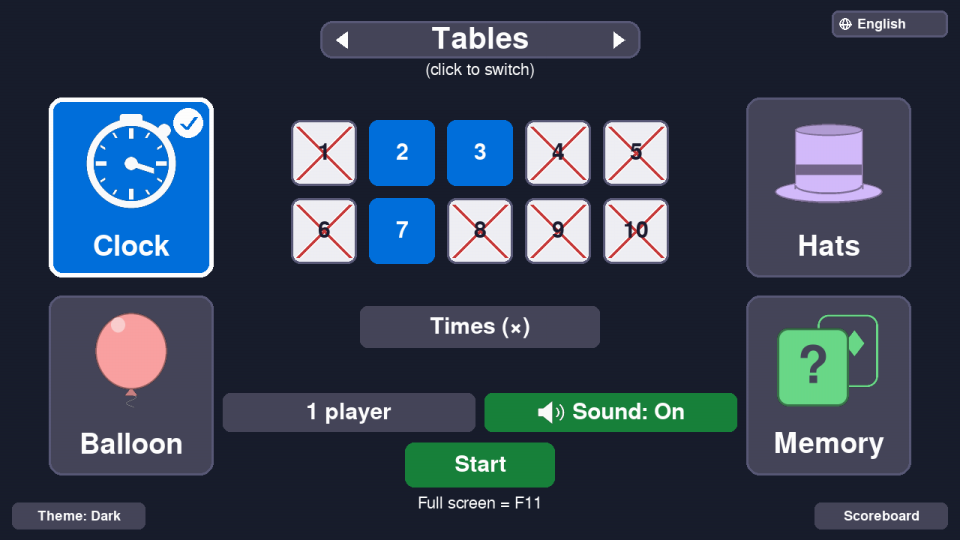
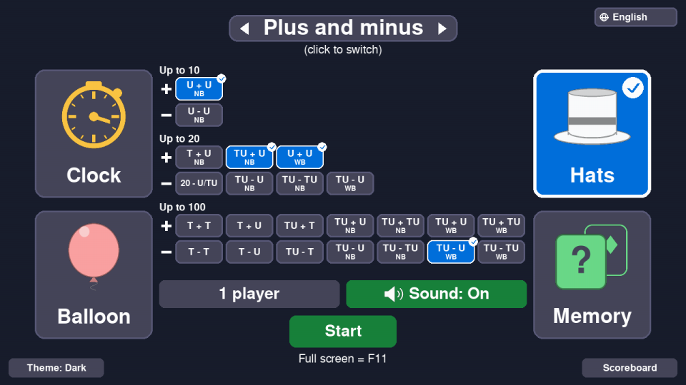
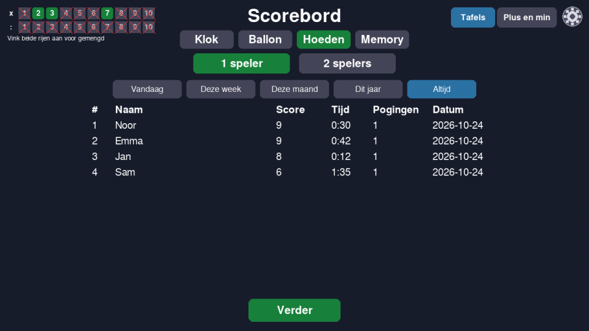

# Tafels

A multiplication-tables and plus/minus practice game for primary school, built for
a classroom: children play **four minigames** on one big screen, alone or in
pairs, with light guns (Sinden) or a mouse. Fully drawn in code - no image files.

| Choose what to practise | Plus and minus |
|---|---|
|  |  |



## What it does

* **Two things to practise** (click the title to switch):
  * **Tables** - times, divided by, or mixed, for any set of tables 1-10.
  * **Plus and minus** - up to 10, 20 and 100, picked type by type
    (units, tens, with or without bridging the ten: 23 types in all).
* **Four games**: Clock (answer cards against a draining clock), Balloon (pop the
  right rising balloon), Hats (remember which hat hides the answer), Memory
  (find sum/answer pairs).
* **One or two players**, taking turns or racing - depending on the game.
* **A scoreboard** per game, per number of players and per exact selection, with
  a hidden timer that breaks ties; a management screen to delete scores.
* **Readable by design**: dark, light and rainbow themes, all text checked for
  contrast.
* **Languages**: Dutch and English built in; adding another is one small text
  file - see [docs/TRANSLATING.md](docs/TRANSLATING.md).

## Run it

```
pip install -r requirements.txt
python main.py
```

Needs Python 3 and pygame (developed with Python 3.12 and 3.13). **F11** toggles full screen,
**Esc** quits.

Input: with Sinden light guns on Linux (`pip install -r requirements-linux.txt`)
each gun is a separate player. Everywhere else the mouse is player 1 and the
arrow keys + Enter are player 2.

## Your data

`settings.json` (your choices) and `leaderboard.json` (**the children's names and
scores**) are written next to the program. They are in `.gitignore` - **never
publish them**. Set the environment variable `TAFELS_DATA_DIR` to keep them
somewhere else (a USB stick, a school drive).

## Download the apps / build them yourself

Every release has a ready-made app for **Windows**, **macOS** and **Linux** (the macOS
app is built on GitHub's current macOS machines, which are Apple Silicon). They are not code-signed, so Windows may show "unknown publisher" and
macOS may need *right-click -> Open* the first time.

To build one yourself:

```
pip install -r requirements.txt -r requirements-build.txt
python -m PyInstaller --noconfirm tafels.spec      # result in dist/
python package_release.py linux                    # optional: zip into release/
```

The GitHub workflow (`.github/workflows/build.yml`) does this for all three
systems on every push, starts each built app with `--selftest` to check it, and
attaches the zips to a Release when you push a tag such as `v1.0.0`.

`Tafels --selftest` (or `python main.py --selftest`) checks the install without
opening a window: languages, sounds, a writable data folder, and that every screen
and game draws.

## Tests

```
python run_tests.py          # everything (no window or sound device needed)
python run_tests.py --fast   # skip the slowest test
```

## Project layout

| | |
|---|---|
| `main.py` | the screens and how they follow each other |
| `keuzescherm.py`, `leaderboard_screen.py`, `keyboard_input.py`, `chip_panel.py` | the screens |
| `klok.py`, `ballon.py`, `hoeden.py`, `memory.py` | the four games |
| `exercises.py` | the exercises: tables and the 23 plus/minus types |
| `i18n.py`, `lang/` | languages |
| `leaderboard.py` | the scores file (saved choices live in `keuzescherm.py`) |
| `theme.py`, `icons.py`, `sounds.py`, `input_devices.py`, `paths.py` | colours, pictures, sound, input, file locations |
| `tafels.spec`, `package_release.py`, `.github/` | building the apps |
| `test_*.py`, `run_tests.py`, `theme_audit.py`, `audit_screens.py` | tests |

## License

*Not chosen yet - add a `LICENSE` file before publishing.*
